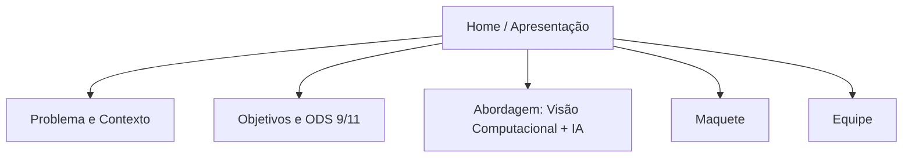

# SmartTraffic — Website

## Descrição

Site de apresentação do **SmartTraffic**

> Este site **não** é o painel administrativo de operadores. Ele é uma vitrine pública do projeto acadêmico — não envia comandos ao Arduino nem controla semáforos.

## Tecnologias

| Camada      | Tecnologias              |
|-------------|--------------------------|
| Frontend    | React, TypeScript, Vite  |
| Estilização | Tailwind CSS             |
| Ambiente    | Node.js 24, npm          |

## Funcionalidades

- Página de apresentação do projeto SmartTraffic
- Explicação da abordagem com visão computacional e IA
- Site institucional

## Estrutura do Repositório

```
smartraffic-web/
├── imgs/             -> imagens utilizadas para o website
├── src/              -> Código-fonte React + TypeScript
├── public/           -> Assets estáticos
├── index.html        -> Entrada do Vite
├── package.json      -> Dependências e scripts
├── vite.config.ts    -> Configuração do Vite
├── tailwind.config.* -> Configuração do Tailwind CSS
└── tsconfig.json     -> Configuração do TypeScript
```

## Fluxograma



## Como rodar

Com **Node.js 24** e **npm** instalados, execute na pasta do repositório:

```bash
npm ci
npm run dev
```

Acesse o endereço exibido no terminal, normalmente `http://localhost:5173`.

Para encerrar, pressione `Ctrl + C`.
